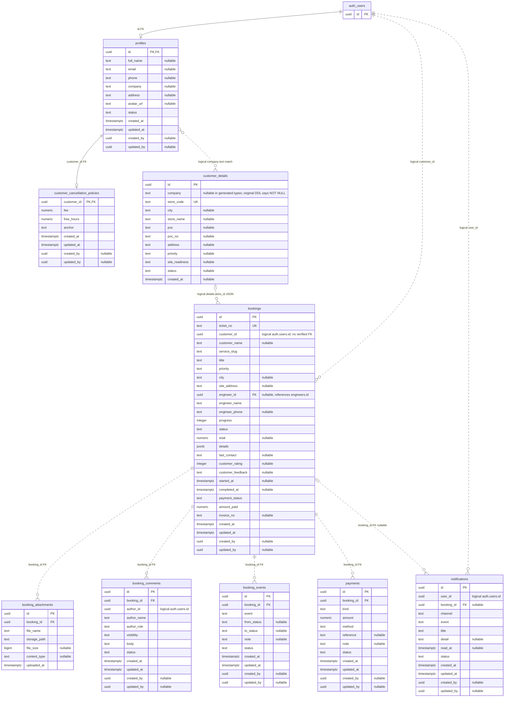
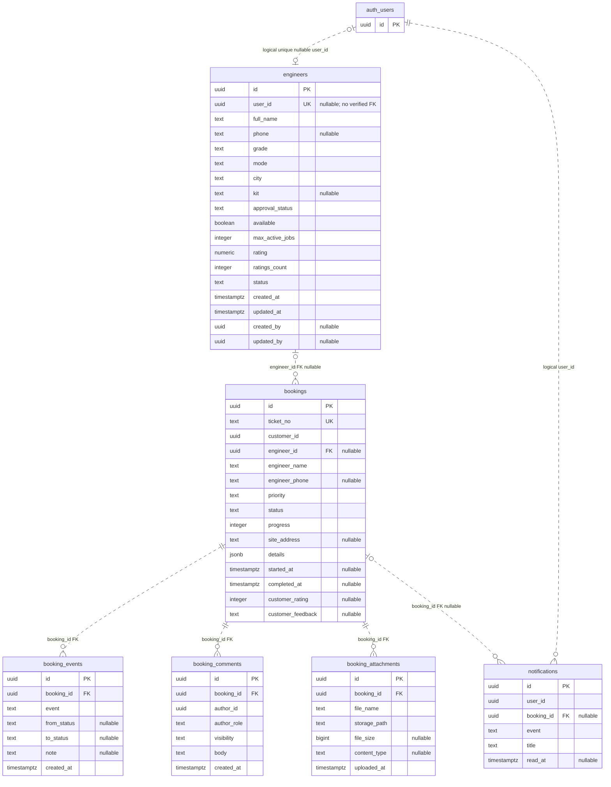
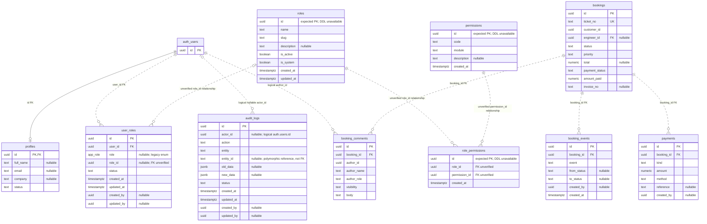

# Customer, Field Engineer, and Project Team ER Diagrams

Based on the checked-in SQL migrations and generated Supabase types, not a live database inspection.

## Reading the Diagrams

- `PK`: primary key; `FK`: foreign key verified in migrations; `UK`: verified unique key.
- Attribute comments say `nullable` where the generated types allow null.
- Relationships labeled `logical` are application links, not verified foreign keys.
- Relationships labeled `unverified` are used by application SQL, but their table-creation migrations were not found.
- Solid/dotted Mermaid lines normally mean identifying/non-identifying relationships. They are not used here as a foreign-key verification legend; read the relationship labels and attribute markers.
- `auth_users` represents Supabase `auth.users`. Only its referenced `id` is shown, not the complete Supabase-managed schema.
- Repeated entities in later diagrams show workflow-relevant columns. Their complete column lists appear in their first diagram.

## 1. Customer

### Booking JSON Is Not a Separate Table

`bookings.details` stores these application properties rather than relational columns:

`clientRequestId`, `level`, `count`, `priority`, `customerType`, `customer`, `gst`, `totalPayable`, `start_date`, `end_date`, `duration`, `hours`, `startTime`, `gpsLocation`, `site`, `contacts`, `store_id`, `store_code`, `store_name`, `poc`, `poc_no`, `address`, `issueDescription`, `workInstructions`.

`site` contains `id`, `code`, `name`, and `address`; each `contacts` element contains `name` and `mobile`. These JSON references have no foreign-key enforcement. New-customer bookings can have no stored site ID.

Files are stored in the private Supabase Storage bucket `booking-attachments`. `booking_attachments.storage_path` identifies the object; it is not a verified FK to `storage.objects`.

## 2. Field Engineer

- One engineer can be assigned many bookings; a booking has zero or one assigned engineer.
- `bookings.details.count` can request multiple engineers, but there is no booking-engineer junction table in the inspected schema.
- Assignment and job actions are controlled by database functions, not direct client writes to protected lifecycle fields.
- Booking statuses include `Open`, `Assigned`, `In Progress`, `Closed`, and `Cancelled`.
- `bookings.customer_rating` and `customer_feedback` hold per-booking feedback. `engineers.rating` and `ratings_count` hold engineer aggregates.

## 3. Project Team

There is no separate project team or team-membership table in the inspected schema. Team access is modeled through user roles and permissions.

- `user_roles` associates users with roles. The generated schema has both legacy `role` and nullable `role_id` columns.
- `role_permissions` logically implements the many-to-many role/permission relationship.
- SQL helpers join these tables and check active roles and permissions. Their creation DDL and FK constraints were not found in the repository, so these constraints are not asserted here.
- Permissions authorize operations; they are not ownership relationships to particular booking rows or project records.
- Payments and refunds are recorded through `record_payment`. Invoice number and payment summary live on `bookings`; no separate invoice table was found.

## Scope and Sources

These are workflow-focused diagrams, not the complete application database. Catalog/configuration tables such as `services`, `rate_cards`, `priorities`, `materials`, and `system_settings` are outside these three views.

- [Generated table columns](src/integrations/supabase/types.ts)
- [User profiles, roles, and audit schema](drizzle/migrations/0000_migration.sql)
- [Bookings, comments, events, and notifications](drizzle/migrations/0001_bookings_tracking_notifications.sql)
- [Engineer schema and assignment foreign key](drizzle/migrations/0002_engineers_assignment.sql)
- [Payment schema](drizzle/migrations/0006_payments_invoices.sql)
- [Attachment schema](drizzle/migrations/0008_booking_attachments.sql)
- [Role and permission SQL joins](drizzle/migrations/0009_permission_based_access.sql)
- [Customer site schema](drizzle/migrations/0017_create_customer_details_table.sql)
- [Customer cancellation policy schema](drizzle/migrations/0020_customer_cancellation_policies.sql)
- [Assignment acceptance and booking statuses](drizzle/migrations/0041_engineer_assignment_acceptance.sql)